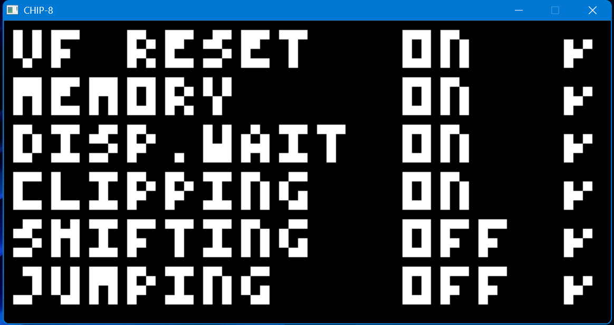
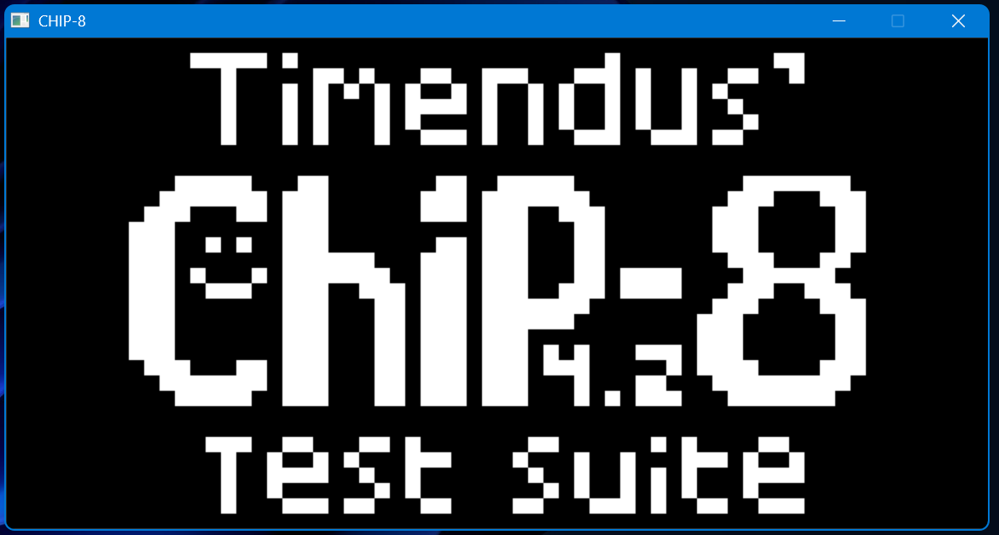
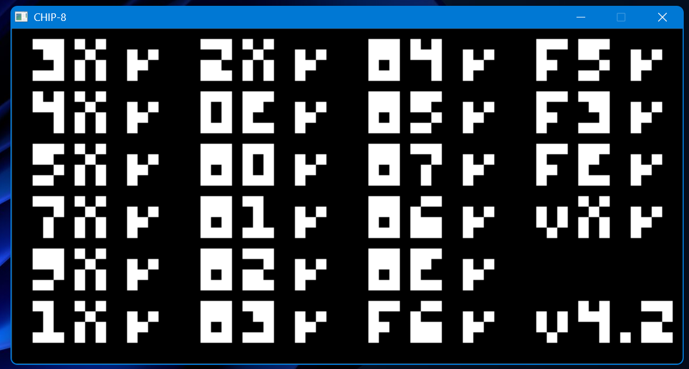
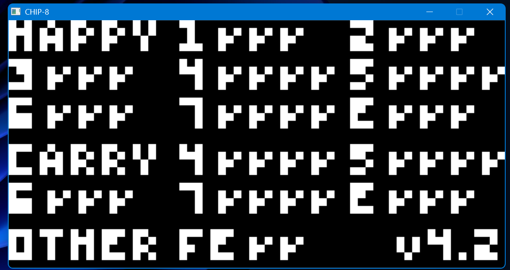

# CHIP-8 Emulator (C++17 + SDL2)

A CHIP-8 interpreter written from scratch in C++17. The emulation core (`chip8.cpp`) has no dependencies and is separated from the SDL2 frontend (`main.cpp`), so it can be unit-tested headlessly.

Passes the [Timendus CHIP-8 test suite](https://github.com/Timendus/chip8-test-suite) (logo, Corax+, flags, quirks):

| Quirks (6/6) | Logo |
|---|---|
|  |  |
| **Corax+ (all opcodes pass)** | **Flags (all pass)** |
|  |  |

## Features

- All 35 standard CHIP-8 opcodes
- 64x32 display with XOR sprite drawing, collision flag and edge clipping
- 60 Hz delay and sound timers; CPU speed set per frame (`--ipf`, default 12 = about 720 instructions per second)
- Quirk profiles as data (`Quirks` struct) instead of scattered `#ifdef`s:
  - default: original CHIP-8 behaviour (VF reset, `FX55/FX65` increment `I`, display wait, clipping, shift uses Vy, `BNNN` uses V0)
  - `--modern`: CHIP-48/SCHIP-style behaviour
- Standard keypad mapping on a QWERTY keyboard

```
CHIP-8        Keyboard
1 2 3 C       1 2 3 4
4 5 6 D       Q W E R
7 8 9 E       A S D F
A 0 B F       Z X C V
```

## Test results

| Suite | Result |
|-------|--------|
| Unit tests (`make test`, 14 tests: arithmetic and flags, call/return, skips, BCD, load/store, drawing, collision, clipping, key wait, timers) | 14/14 pass |
| [Timendus quirks test](https://github.com/Timendus/chip8-test-suite) (CHIP-8 platform) | 6/6 pass |
| Timendus `1-chip8-logo` | pass |
| Timendus `3-corax+` (opcode correctness) | all pass |
| Timendus `4-flags` (carry/borrow/shift flags) | all pass |

## Build and run

Linux / macOS:

```bash
# Ubuntu/Debian: sudo apt install g++ make libsdl2-dev
# macOS:         brew install sdl2
make
./chip8 path/to/rom.ch8 [--modern] [--scale 12] [--ipf 12]
```

Windows (MSYS2 MinGW64 shell):

```bash
pacman -S mingw-w64-x86_64-gcc make mingw-w64-x86_64-SDL2
make
./chip8.exe path/to/rom.ch8
```

Windows (plain MinGW-w64 + SDL2 development zip):

```bash
mingw32-make SDL2_DIR=C:/SDL2/x86_64-w64-mingw32
```

Copy `SDL2.dll` next to `chip8.exe`. Run the unit tests (no SDL2 needed) with `make test`.

## Design notes

- `Chip8::cycle()` does fetch, decode and execute with one `switch` on the top nibble.
- The display wait quirk (`DXYN` draws at most once per 60 Hz frame) is implemented with a `vblank_` flag set by `tickTimers()`. A second draw in the same frame re-executes the instruction until the next tick.
- Unit tests assemble tiny programs as byte arrays and assert on registers, memory and the display buffer.
- Failures found along the way: the first quirks run failed 3 of 6 (memory, display wait, shifting). Display wait had not been implemented, and the other two were using the modern profile by default.

## Possible next steps

- SUPER-CHIP support (128x64 display, scrolling)
